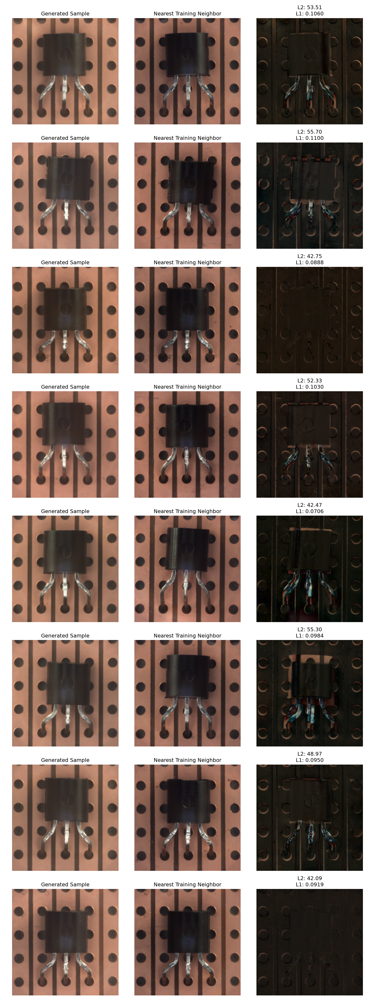
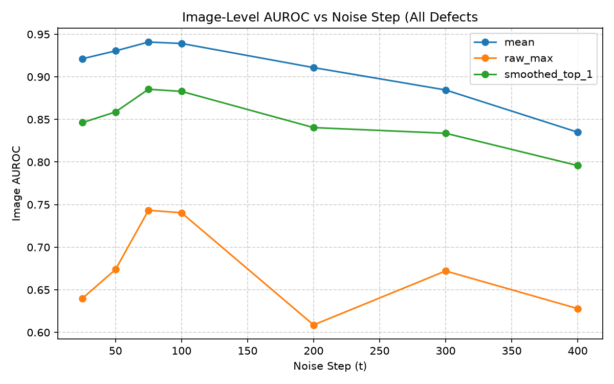
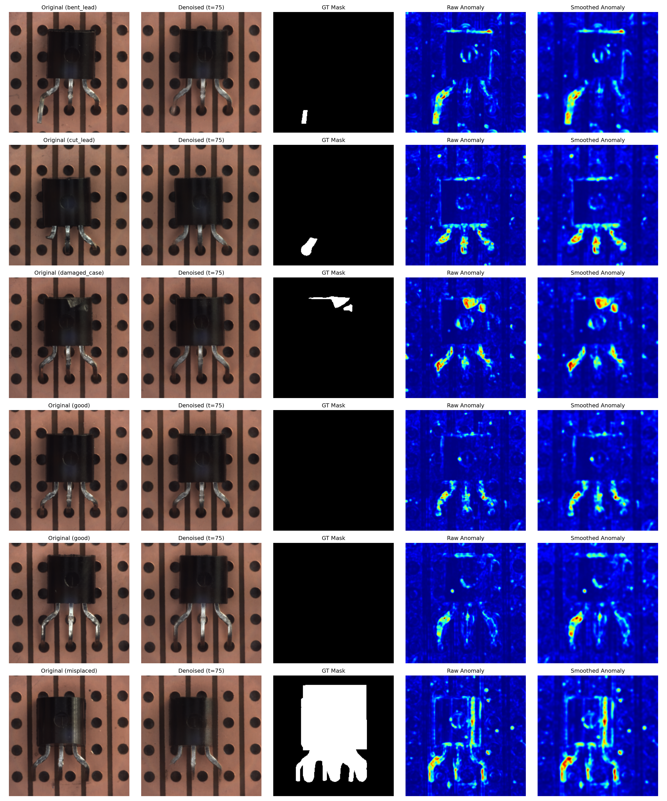

# DDPM from Scratch: Generation and Reconstruction-Based Anomaly Detection on MVTec AD (Transistor)

A from-scratch PyTorch implementation of Denoising Diffusion Probabilistic Models (Ho et al., 2020), trained on the MVTec AD `transistor` class. The project covers unconditional image generation and an evaluation of whether the same model can be used for unsupervised defect detection by noising an image, denoising it, and comparing the result to the input.

Training curves and sample grids were tracked with Weights & Biases: [W&B report](<WANDB_REPORT_URL>).

## Summary of results

- The model generates plausible transistor images from pure noise. A nearest-neighbor check against all training images (and their flips) found no sign of memorization.
- As a reconstruction-based anomaly detector (SSIM anomaly map), it reaches **image-level AUROC of about 0.94** and **pixel-level AUROC of 0.77** on the 100-image MVTec test set. These are best-of-sweep numbers from a single seed (see [Limitations](#limitations)).
- Detection is strong for large or structural defects (`misplaced`, `bent_lead`) and weakest for `cut_lead`.

## Implementation

Everything below was written from scratch (no diffusion or U-Net libraries):

- **Noise schedule and sampler:** 1000 timesteps, linear beta schedule from 1e-4 to 0.02, closed-form forward process, ancestral sampling with the posterior mean and fixed variance (sigma squared = beta_t).
- **U-Net:** 64 base channels and 4 resolution levels (64, 128, 256, 512), residual blocks with GroupNorm (32 groups) and SiLU, sinusoidal timestep embedding passed through an MLP and injected into every residual block, skip connections, multi-head self-attention in the 16x16 bottleneck, nearest-neighbor upsampling.
- **Training:** epsilon-prediction with MSE loss, Adam (lr 1e-4), batch size 16, bf16 autocast, random horizontal flip, EMA of weights (decay 0.9999). Images resized from 1024x1024 to 256x256 and scaled to [-1, 1]. The checkpoint from epoch 3650 (EMA weights) is used for every experiment below.
- **Differences from the paper:** 64 base channels instead of 128 and a learning rate of 1e-4 instead of 2e-4, to fit the compute available.
- **Data:** MVTec AD `transistor`: 213 defect-free training images; test set of 100 images (60 good, 10 each of `bent_lead`, `cut_lead`, `damaged_case`, `misplaced`) with pixel-level ground-truth masks. The model only ever sees defect-free training images.

## Experiment 1: Image generation

Eight samples generated from random noise (seed 42), each shown next to its nearest training image and the absolute difference:



**Memorization check.** Nearest neighbors were searched in pixel space (L2) over all 213 training images plus their horizontal flips (426 reference images). As a baseline, the same distance was computed for the 60 held-out good test images.

| Pair | Mean L2 to nearest training image | Std |
|---|---|---|
| Generated samples (n = 8) | 49.14 | 5.54 |
| Held-out real good images (n = 60) | 28.14 | 3.43 |

No generated sample is as close to the training set as an average held-out real image, so there is no evidence the model copies training images. Two of the eight samples (rows 3 and 8 in the figure) do resemble their nearest neighbor closely in layout.

The gap also shows that generated samples are farther from the training images than real held-out images are, so this is not a quality metric. Pixel-space L2 is also sensitive to small positional shifts, and it was run on only eight samples. Qualitatively, the least faithful region appears to be the fine metallic texture of the leads (a visual impression, not quantified).

## Experiment 2: Anomaly detection by reconstruction

### Method

1. Add noise to a test image up to timestep t (using the same initial noise for every t, seed 42).
2. Run the learned reverse process from t down to 0 to get a "reconstructed" image.
3. Compute the SSIM map between the reconstruction and the original (torchmetrics defaults: 11x11 Gaussian window, sigma 1.5, images in [0, 1], channels averaged), and define the anomaly map as `1 - SSIM`.
4. Reduce the anomaly map to one score per image in three ways:
   - `mean`: mean of the whole anomaly map
   - `raw_max`: maximum pixel value
   - `smoothed_top_1`: mean of the top 1% of pixels after a 5x5 Gaussian blur (sigma 2)

### Evaluation protocol

- Threshold-free: AUROC on image-level scores (good = 0, defective = 1).
- Pixel-level AUROC pools every pixel of all 100 test images, including the 60 good images (all-zero masks), so false alarms on healthy parts are penalized.
- Test images and masks resized to 256x256 (masks with nearest-neighbor interpolation).
- Noise level swept over t in {25, 50, 75, 100, 200, 300, 400}.

### Results

| t | Image AUROC (mean) | Image AUROC (raw max) | Image AUROC (smoothed top-1%) | Pixel AUROC |
|---|---|---|---|---|
| 25 | 0.921 | 0.640 | 0.846 | 0.722 |
| 50 | 0.930 | 0.674 | 0.859 | 0.754 |
| **75** | **0.941** | 0.743 | 0.885 | 0.766 |
| 100 | 0.939 | 0.740 | 0.883 | 0.772 |
| 200 | 0.911 | 0.609 | 0.840 | 0.774 |
| 300 | 0.885 | 0.672 | 0.834 | 0.779 |
| 400 | 0.835 | 0.628 | 0.796 | 0.766 |



Per-defect image AUROC at t = 75 (good images vs. one defect type, 10 defective images each):

| Defect type | Mean score | Smoothed top-1% |
|---|---|---|
| bent_lead | 0.995 | 0.990 |
| cut_lead | 0.870 | 0.863 |
| damaged_case | 0.898 | 0.877 |
| misplaced | 1.000 | 0.812 |

Qualitative results at t = 75 (first example of each defect type and two good images; columns: original, reconstruction, ground-truth mask, raw anomaly map, smoothed anomaly map):



### Findings

- **Noise level has an interior optimum.** Image AUROC is highest around t = 50 to 100 and falls at larger t, consistent with the intuition that too little noise lets the model copy a defect while too much noise changes the object itself. The differences within the 50 to 100 plateau are within run-to-run noise.
- **The plain mean score beat the localized scores.** I expected top-k scores to win because defects are small, but the mean was best at every noise level. In the anomaly maps, the leads of good images light up too, so local maxima fire on healthy parts. This is a hypothesis from visual inspection of a few maps, not a tested explanation.
- **Smoothing helps relative to the raw maximum** (for example 0.885 vs 0.743 at t = 75), which supports the idea that isolated pixel spikes make the raw maximum unreliable.
- **Defect type matters.** `misplaced` and `bent_lead` are detected nearly perfectly, while `cut_lead` is the weakest. For `cut_lead` the anomaly map highlights all three leads about as strongly as on good images, so localization is not reliable there. At higher t, the smoothed top-1% score handles `cut_lead` better than the mean (0.83 vs 0.70 at t = 400), which fits the idea that small local defects get diluted in a global mean, but each type has only 10 images.
- **Pixel-level localization is modest** (AUROC about 0.77 across noise levels).

## Limitations

- **Selection on the test set.** The noise level and scoring method were chosen by sweeping on the test set, since MVTec provides no defective validation data. The best entries are therefore optimistic.
- **Single seed and small test set.** Two runs with different noise draws gave mean-score AUROCs that differed by up to about 0.03 at the same t (for example 0.853 vs 0.885 at t = 300). Differences smaller than that should not be over-interpreted. With 40 defective and 60 good images (10 per defect type), confidence intervals are wide.
- **One category, no baselines.** Only the `transistor` class was studied, and the method was not compared against established methods such as PatchCore or other diffusion-based detectors.
- **Resolution.** Images were downsampled from 1024x1024 to 256x256, which can remove small defects.
- **Generation quality is not quantified.** No FID or similar metric was computed (213 training images is too few for it to be reliable). Samples were assessed visually and with the nearest-neighbor check above.

## Reproducing

Dependencies: PyTorch, torchvision, torchmetrics, scikit-learn, pandas, matplotlib, wandb, python-dotenv.

1. Download MVTec AD (see the dataset page for license terms) and place the `transistor` class at `data/transistor/` (with `train/`, `test/`, and `ground_truth/`). The dataset is not included in this repo.
2. Put your Weights & Biases key in a `.env` file as `WANDB_API_KEY=...`.
3. Run:

```bash
python train.py              # train the DDPM; checkpoints saved to ./outputs
python evaluate_ssim.py      # noise/denoise the test set at each t, save SSIM maps
python score_results.py      # AUROCs, plots, qualitative figure
python generate_samples.py   # sample grid and nearest-neighbor check
```

## Project structure

```text
src/
  unet.py            # U-Net: residual blocks, attention, time embedding
  diffusion.py       # noise scheduler and sampler
  load_data.py       # train and test datasets for MVTec transistor
  utils.py           # checkpoint save/load
train.py             # training loop (EMA, bf16, W&B logging)
evaluate_ssim.py     # reconstruction + SSIM maps over the test set
score_results.py     # AUROC computation and figures
generate_samples.py  # generation and nearest-neighbor memorization check
assets/              # figures used in this README
```

## References

- J. Ho, A. Jain, P. Abbeel. *Denoising Diffusion Probabilistic Models.* NeurIPS 2020. https://arxiv.org/abs/2006.11239
- P. Bergmann et al. *MVTec AD: A Comprehensive Real-World Dataset for Unsupervised Anomaly Detection.* CVPR 2019.
